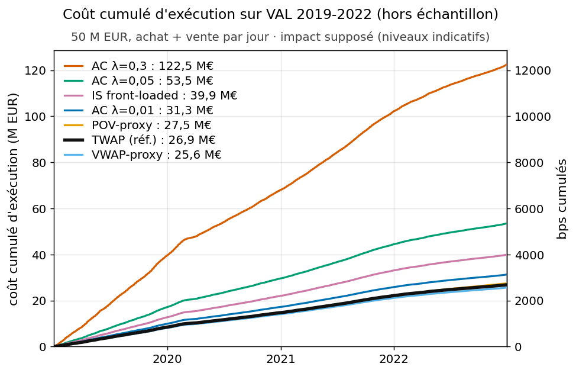
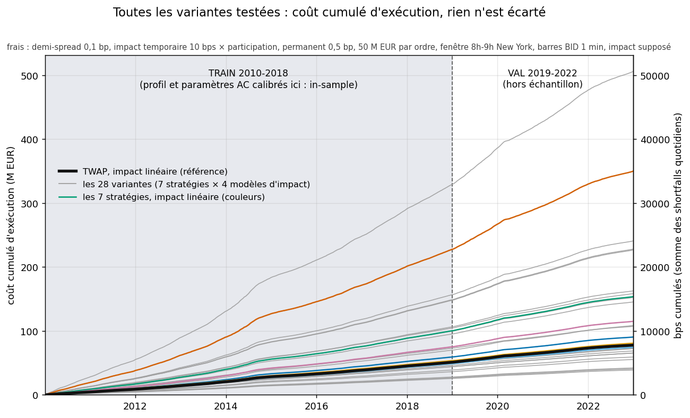
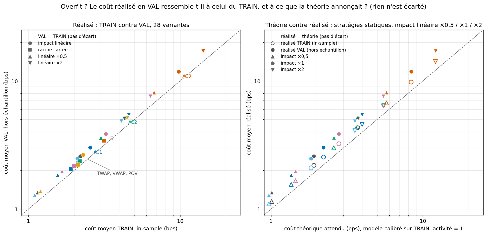
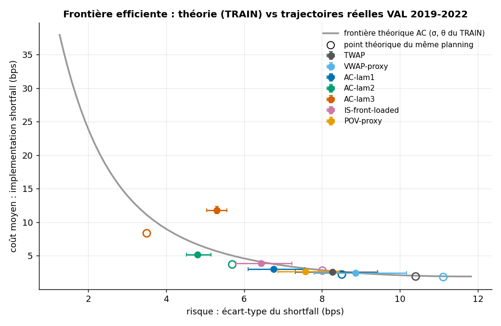
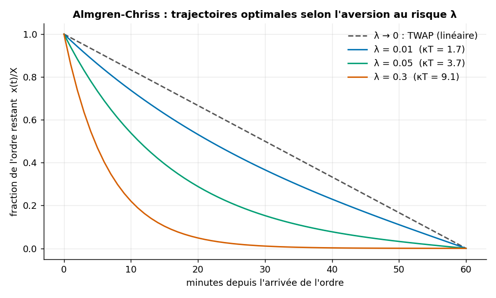
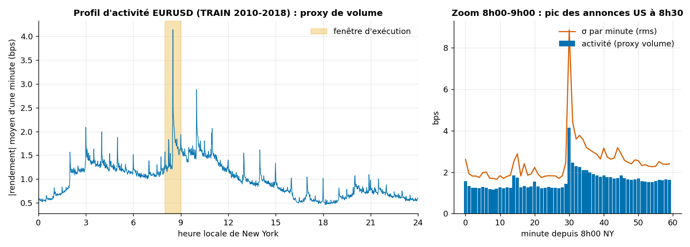
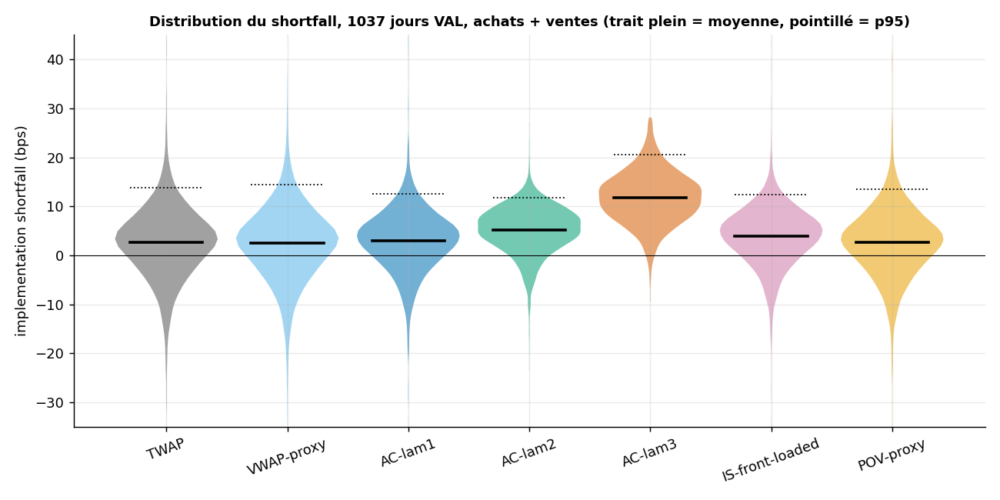
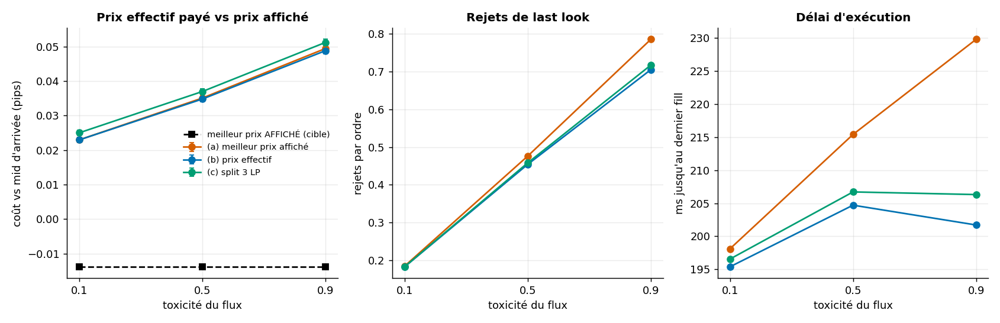

# Exécution optimale et agrégation de liquidité FX : combien coûte un ordre de 50 M EUR ?

Comment exécuter un gros ordre FX sans payer trop d'impact ni porter trop de risque (Almgren-Chriss, TWAP, VWAP-proxy, POV, IS), mesuré par une analyse de coûts de transaction (TCA) rejouée jour après jour sur de vrais prix EURUSD 1 minute, puis comment le router entre 8 fournisseurs de liquidité dont certains font du *last look*. Le résultat honnête : un arbitrage coût / risque dont la forme dépend d'un impact de marché que ces données ne permettent pas d'estimer.

*A transaction-cost analysis of a 50 M EUR EURUSD order replayed day by day on real 1-minute data (Almgren-Chriss, TWAP, VWAP-proxy, POV, IS; linear and square-root impact; TRAIN in-sample, VAL out-of-sample), plus a liquidity-aggregator simulator (8 LPs, last look, 3 smart order routers). Impact is assumed, not estimated: expected cost comes from the model, price risk from real data.*

  

<!-- AUTO:TETE -->
### Frais et hypothèses

| Hypothèse | Valeur |
|---|---|
| Ordre | 50 M EUR d'EURUSD, **un achat ET une vente rejoués chaque jour**, 60 tranches d'une minute, fenêtre 8h00-9h00 heure de New York (les annonces US de 8h30 y sont), prix d'arrivée = clôture de 7h59 |
| Demi-spread | 0,1 bp du notionnel, constant et identique pour toutes les stratégies (**hypothèse** : les barres BID ne contiennent pas de spread réel) |
| Impact supposé | temporaire **linéaire** : 10 bps × participation (modèle principal) ; **racine carrée** : y·σ·√participation avec y = 1,557, calibré pour égaler le linéaire au TWAP nominal ; permanent linéaire : 0,5 bp pour l'ordre complet. Sensibilités : impact ×0,5 et ×2. **Aucun impact n'est estimé sur des fills** |
| Liquidité | 5 Md EUR par jour accessibles (hypothèse ; le marché fait environ 1 000 Md) donc participation TWAP nominale 14,9 % ; volume d'une minute = volume du jour × part de la minute (profil d'activité TRAIN) × activité réalisée du jour |
| Données | HistData EURUSD 1 minute, prix **BID** ; le FX est OTC, la colonne volume vaut 0 : l'activité de prix sert de proxy ; horloge = heure locale de New York (heure d'été comprise), vérifiée sur le NFP et l'ouverture hebdomadaire |
| Découpage | **TRAIN** 2010-2018 (2 329 jours utilisables sur 2 342 : profil, σ et θ d'Almgren-Chriss calibrés ici, donc le rejeu TRAIN est **in-sample**) · **VAL** 2019-2022 (1 037 jours sur 1 043 : évaluation hors échantillon) · **TEST 2023+ : scellé**, le chargeur refuse l'année |
| Délai d'exécution | la tranche k est décidée avec les clôtures jusqu'à la minute précédente (testé), exécutée au prix de la barre ; aucune latence sous la minute dans le TCA (l'agrégateur, lui, simule la milliseconde) |
| Statistiques | shortfall en bps du notionnel, positif = on paie ; achat et vente moyennés (la dérive du prix s'annule : la moyenne mesure l'impact, l'écart-type le risque de prix) ; IC95 par bootstrap en blocs de 5 jours (1 000 tirages), mêmes blocs pour toutes les stratégies ; coût total en EUR = jours × (1 achat + 1 vente) × 50 M EUR × shortfall moyen |
| Essais | 28 variantes (7 stratégies × 4 modèles d'impact), toutes publiées, **aucune choisie sur VAL** : pas de DSR (rien à déflater) |

### Coût d'exécution par stratégie, impact linéaire, TRAIN | VAL côte à côte

| Stratégie | Shortfall moyen TRAIN [IC95] | Shortfall moyen VAL [IC95] | Écart-type TRAIN | Écart-type VAL | p95 TRAIN | p95 VAL | Coût total VAL (M EUR) | Δ vs TWAP VAL [IC95] |
|---|---|---|---|---|---|---|---|---|
| TWAP | 2,19 [2,14 ; 2,24] | 2,59 [2,49 ; 2,69] | 10,01 | 8,26 | 16,5 | 13,8 | 26,9 | référence |
| VWAP-proxy | 2,09 [2,05 ; 2,14] | 2,47 [2,37 ; 2,57] | 10,65 | 8,86 | 17,4 | 14,4 | 25,6 | −0,12 [−0,12 ; −0,11] |
| Almgren-Chriss λ=0,01 | 2,54 [2,48 ; 2,61] | 3,02 [2,90 ; 3,14] | 8,25 | 6,76 | 14,1 | 12,5 | 31,3 | +0,43 [+0,41 ; +0,45] |
| Almgren-Chriss λ=0,05 | 4,30 [4,19 ; 4,42] | 5,16 [4,94 ; 5,38] | 5,82 | 4,81 | 12,0 | 11,8 | 53,5 | +2,57 [+2,45 ; +2,69] |
| Almgren-Chriss λ=0,3 | 9,78 [9,51 ; 10,05] | 11,82 [11,29 ; 12,34] | 5,32 | 5,30 | 17,8 | 20,5 | 122,5 | +9,23 [+8,80 ; +9,65] |
| IS front-loaded | 3,23 [3,15 ; 3,31] | 3,85 [3,69 ; 4,01] | 7,87 | 6,43 | 13,9 | 12,3 | 39,9 | +1,26 [+1,20 ; +1,32] |
| POV-proxy | 2,29 [2,25 ; 2,34] | 2,65 [2,57 ; 2,74] | 8,98 | 7,58 | 15,6 | 13,5 | 27,5 | +0,06 [+0,04 ; +0,08] |

### Coût d'exécution par stratégie, impact racine carrée, TRAIN | VAL côte à côte

| Stratégie | Shortfall moyen TRAIN [IC95] | Shortfall moyen VAL [IC95] | Écart-type TRAIN | Écart-type VAL | p95 TRAIN | p95 VAL | Coût total VAL (M EUR) | Δ vs TWAP VAL [IC95] |
|---|---|---|---|---|---|---|---|---|
| TWAP | 1,90 [1,88 ; 1,92] | 2,06 [2,02 ; 2,10] | 9,99 | 8,22 | 16,5 | 13,6 | 21,3 | référence |
| VWAP-proxy | 2,11 [2,08 ; 2,13] | 2,29 [2,24 ; 2,33] | 10,63 | 8,83 | 17,6 | 14,4 | 23,7 | +0,23 [+0,23 ; +0,24] |
| Almgren-Chriss λ=0,01 | 1,90 [1,87 ; 1,92] | 2,05 [2,01 ; 2,09] | 8,21 | 6,69 | 13,8 | 11,8 | 21,3 | −0,002 [−0,002 ; −0,002] |
| Almgren-Chriss λ=0,05 | 2,17 [2,15 ; 2,20] | 2,36 [2,31 ; 2,41] | 5,59 | 4,43 | 10,1 | 9,1 | 24,5 | +0,30 [+0,30 ; +0,31] |
| Almgren-Chriss λ=0,3 | 3,14 [3,10 ; 3,18] | 3,42 [3,35 ; 3,50] | 3,61 | 2,74 | 7,8 | 7,5 | 35,5 | +1,37 [+1,33 ; +1,40] |
| IS front-loaded | 1,99 [1,97 ; 2,01] | 2,16 [2,12 ; 2,20] | 7,78 | 6,29 | 13,2 | 11,2 | 22,4 | +0,10 [+0,10 ; +0,11] |
| POV-proxy | 2,12 [2,11 ; 2,13] | 2,22 [2,20 ; 2,25] | 8,96 | 7,54 | 15,5 | 13,3 | 23,0 | +0,16 [+0,15 ; +0,18] |

*Shortfall en bps du notionnel (positif = coût), achats et ventes poolés ; l'écart-type est celui d'un seul ordre. Coût total VAL en M EUR pour le flux hypothétique d'un achat et d'une vente de 50 M EUR par jour. Modèles d'impact supposés, jamais estimés : voir l'encadré.*
<!-- /AUTO:TETE -->



**Comment lire ce graphique.** Ici la « performance » est un coût. En haut : coût cumulé d'exécution sur VAL (un achat et une vente de 50 M EUR chaque jour, impact linéaire), en M EUR à gauche et en bps cumulés à droite. La pente d'une courbe est le coût moyen par jour ; TWAP, en noir gras, est la référence : une courbe au-dessus coûte plus cher, une courbe en dessous coûte moins. En bas : le coût du jour moyenné sur 60 jours (échelle log) n'est pas constant, il suit l'activité du marché (moins de volume pour la même taille, donc plus d'impact). Les courbes les plus chères sont celles qui réduisent le plus le risque : cette contrepartie ne se lit pas ici, elle est dans la frontière plus bas.

<!-- AUTO:ROBUSTE -->
### Robuste ou pas ? Lecture en 30 secondes

1. **La théorie calibrée sur TRAIN se trompe dans les deux sens hors échantillon.** TWAP : coût théorique 1,91 bps et écart-type 10,4 ; réalisé en TRAIN (in-sample) 2,19 et 10,0 ; réalisé en VAL 2,59 et 8,3. Le coût est 35 % au-dessus de la théorie en VAL (déjà 14 % en TRAIN) et le risque 21 % en dessous. Causes : l'impact varie comme l'inverse de l'activité du jour m, dont la moyenne de l'inverse dépasse l'inverse de la moyenne que la théorie suppose (E[1/m] = 1,18 en TRAIN pour une activité moyenne de 1,00, 1,43 en VAL pour 0,84) ; et VAL est plus calme (σ de fenêtre 2,18 contre 2,68 bps/min), donc moins de risque de prix.
2. **Le classement, lui, tient.** Corrélation de rang (Spearman) des 7 coûts moyens TRAIN / VAL : 1,00 en impact linéaire, 0,96 en racine carrée ; le coût VAL vaut 1,15 à 1,21 fois le coût TRAIN selon la stratégie (linéaire). Les gagnants par aversion au risque (utilité E + λ·Var) sont les mêmes en TRAIN et en VAL : pour λ = 0,01 / 0,05 / 0,3, POV-proxy / Almgren-Chriss λ=0,01 / Almgren-Chriss λ=0,05 (l'optimum du modèle serait Almgren-Chriss λ=0,01 / Almgren-Chriss λ=0,05 / Almgren-Chriss λ=0,3).
3. **Choisi avant de lire VAL : les paramètres.** Taille, fenêtre, modèles d'impact et leurs paramètres, valeurs de λ, stratégies sont des constantes du code (`execfx/impact.py`, `execfx/experiences.py`), aucune n'a été ajustée pour améliorer un résultat VAL (une seule exécution de référence) ; la seule modification venue après un premier calcul est la correction du fuseau de la relecture du 13/10 (elle déplace la fenêtre, pas les paramètres). Les 28 variantes sont toutes publiées, aucune n'est retenue sur son résultat VAL, TEST scellé. Le vrai point faible n'est pas un surajustement mais l'**impact supposé** : AC λ=0,3 coûte 11,82 bps en linéaire et 3,42 en racine carrée, et la frontière coût / risque empirique se replie : AC λ=0,3 est plus risquée (5,30) qu'AC λ=0,05 (4,81) car l'impact varie d'un jour à l'autre, ce que la théorie ignore.

| Stratégie (impact linéaire) | Coût théorique | Réalisé TRAIN | Réalisé VAL | Écart-type théorique | Écart-type TRAIN | Écart-type VAL |
|---|---|---|---|---|---|---|
| TWAP | 1,91 | 2,19 | 2,59 | 10,40 | 10,01 | 8,26 |
| VWAP-proxy | 1,83 | 2,09 | 2,47 | 11,11 | 10,65 | 8,86 |
| Almgren-Chriss λ=0,01 | 2,21 | 2,54 | 3,02 | 8,51 | 8,25 | 6,76 |
| Almgren-Chriss λ=0,05 | 3,71 | 4,30 | 5,16 | 5,70 | 5,82 | 4,81 |
| Almgren-Chriss λ=0,3 | 8,36 | 9,78 | 11,82 | 3,50 | 5,32 | 5,30 |
| IS front-loaded | 2,79 | 3,23 | 3,85 | 8,01 | 7,87 | 6,43 |
| POV-proxy | n/d (adaptative) | 2,29 | 2,65 | n/d | 8,98 | 7,58 |

*bps du notionnel. La théorie (formules d'Almgren-Chriss avec les σ et θ du TRAIN, activité du jour = 1) n'existe que pour les plannings statiques ; POV s'adapte à l'activité observée.*
<!-- /AUTO:ROBUSTE -->

## Toutes les variantes

Rien n'est caché : 7 stratégies × 4 modèles d'impact (linéaire, racine carrée, linéaire ×0,5 et ×2), TRAIN et VAL, **y compris les cas où la théorie se trompe**. Aucune n'est retenue sur son résultat VAL.

<!-- AUTO:VARIANTES -->
| Variante | Impact | Shortfall moyen TRAIN | Shortfall moyen VAL | Écart-type TRAIN | Écart-type VAL | p95 VAL | Coût total VAL (M EUR) | Rapport VAL / TRAIN |
|---|---|---|---|---|---|---|---|---|
| **TWAP·lin** | linéaire | 2,19 | 2,59 | 10,01 | 8,26 | 13,8 | 26,9 | 1,18 |
| VWAP·lin | linéaire | 2,09 | 2,47 | 10,65 | 8,86 | 14,4 | 25,6 | 1,18 |
| AC1·lin | linéaire | 2,54 | 3,02 | 8,25 | 6,76 | 12,5 | 31,3 | 1,19 |
| AC2·lin | linéaire | 4,30 | 5,16 | 5,82 | 4,81 | 11,8 | 53,5 | 1,20 |
| AC3·lin | linéaire | 9,78 | 11,82 | 5,32 | 5,30 | 20,5 | 122,5 | 1,21 |
| IS·lin | linéaire | 3,23 | 3,85 | 7,87 | 6,43 | 12,3 | 39,9 | 1,19 |
| POV·lin | linéaire | 2,29 | 2,65 | 8,98 | 7,58 | 13,5 | 27,5 | 1,15 |
| TWAP·rac | racine carrée | 1,90 | 2,06 | 9,99 | 8,22 | 13,6 | 21,3 | 1,08 |
| VWAP·rac | racine carrée | 2,11 | 2,29 | 10,63 | 8,83 | 14,4 | 23,7 | 1,09 |
| AC1·rac | racine carrée | 1,90 | 2,05 | 8,21 | 6,69 | 11,8 | 21,3 | 1,08 |
| AC2·rac | racine carrée | 2,17 | 2,36 | 5,59 | 4,43 | 9,1 | 24,5 | 1,09 |
| AC3·rac | racine carrée | 3,14 | 3,42 | 3,61 | 2,74 | 7,5 | 35,5 | 1,09 |
| IS·rac | racine carrée | 1,99 | 2,16 | 7,78 | 6,29 | 11,2 | 22,4 | 1,08 |
| POV·rac | racine carrée | 2,12 | 2,22 | 8,96 | 7,54 | 13,3 | 23,0 | 1,05 |
| TWAP·lin×0,5 | linéaire ×0,5 | 1,15 | 1,34 | 9,99 | 8,23 | 12,8 | 13,9 | 1,17 |
| VWAP·lin×0,5 | linéaire ×0,5 | 1,10 | 1,29 | 10,63 | 8,83 | 13,4 | 13,3 | 1,17 |
| AC1·lin×0,5 | linéaire ×0,5 | 1,56 | 1,84 | 7,15 | 5,79 | 10,3 | 19,1 | 1,19 |
| AC2·lin×0,5 | linéaire ×0,5 | 3,00 | 3,60 | 4,76 | 3,82 | 9,1 | 37,4 | 1,20 |
| AC3·lin×0,5 | linéaire ×0,5 | 6,73 | 8,14 | 4,08 | 3,87 | 14,3 | 84,4 | 1,21 |
| IS·lin×0,5 | linéaire ×0,5 | 1,66 | 1,98 | 7,80 | 6,32 | 10,9 | 20,5 | 1,19 |
| POV·lin×0,5 | linéaire ×0,5 | 1,20 | 1,38 | 8,96 | 7,55 | 12,4 | 14,3 | 1,15 |
| TWAP·lin×2 | linéaire ×2 | 4,28 | 5,08 | 10,10 | 8,41 | 15,9 | 52,7 | 1,19 |
| VWAP·lin×2 | linéaire ×2 | 4,09 | 4,84 | 10,73 | 8,98 | 16,1 | 50,2 | 1,18 |
| AC1·lin×2 | linéaire ×2 | 4,57 | 5,43 | 9,12 | 7,59 | 15,0 | 56,3 | 1,19 |
| AC2·lin×2 | linéaire ×2 | 6,39 | 7,65 | 7,17 | 6,11 | 16,0 | 79,3 | 1,20 |
| AC3·lin×2 | linéaire ×2 | 14,14 | 17,07 | 7,06 | 7,31 | 29,4 | 177,1 | 1,21 |
| IS·lin×2 | linéaire ×2 | 6,35 | 7,60 | 8,14 | 6,87 | 16,5 | 78,8 | 1,20 |
| POV·lin×2 | linéaire ×2 | 4,49 | 5,20 | 9,05 | 7,70 | 15,7 | 53,9 | 1,16 |

*bps du notionnel, sauf le coût total (M EUR). TWAP en impact linéaire (en gras) est la référence. Colonnes « Impact » : linéaire = modèle principal, racine carrée = calibrée dessus, ×0,5 et ×2 = impacts linéaires multipliés.*
<!-- /AUTO:VARIANTES -->



**Comment lire ce graphique.** Chaque ligne grise est le coût cumulé d'une des 28 variantes, sur TRAIN (zone grisée, in-sample) puis sur VAL (hors échantillon) ; les lignes de couleur sont les 7 stratégies en impact linéaire, TWAP en noir gras. Plus la ligne monte vite, plus l'exécution coûte. Le modèle d'impact choisi (l'écart entre lignes de même couleur) déplace davantage le coût que le choix entre TWAP, VWAP-proxy et POV ; une pente un peu plus forte à droite de la ligne pointillée se lit dans la colonne « Rapport VAL / TRAIN » du tableau.



**Comment lire ce graphique.** À gauche, un point par variante : coût moyen TRAIN en abscisse, VAL en ordonnée (échelles log). Sur la diagonale, VAL = TRAIN ; au-dessus, l'exécution coûte plus cher hors échantillon. À droite, pour les stratégies statiques en impact linéaire, le coût que la théorie d'Almgren-Chriss annonçait (en abscisse) contre le coût réalisé : ronds vides en TRAIN (là où la théorie a été calibrée), ronds pleins en VAL. Une théorie juste aurait tous les points sur la diagonale ; elle la sous-estime déjà en TRAIN, davantage en VAL.

## Tableau de bord interactif

Choisissez vous-même les conditions de départ (modèle d'impact, famille de stratégie, coût moyen TRAIN maximal, écart-type TRAIN maximal) : seules les variantes qui passent ces filtres sur **TRAIN** sont combinées (moyenne équipondérée), et le coût cumulé obtenu est affiché sur TRAIN puis VAL, avec ses métriques recalculées dans le navigateur.

- En ligne : <https://yassine-ek.github.io/fx-optimal-execution-tca/>
- Ou ouvrir `docs/index.html` localement (les données sont dans `docs/data.js`, aucun serveur nécessaire ; sinon lancer `python -m http.server` dans `docs/`).
- Régénérer : `python scripts/exporter_dashboard.py` (lit `results/`, aucune donnée de marché requise).

Essais instructifs : abaisser « Écart-type TRAIN max » pour ne garder que les stratégies les moins risquées (la courbe de coût cumulé monte plus vite : c'est le prix de la réduction de risque) ; ou ne garder que le modèle d'impact « racine carrée », puis « linéaire ×2 », et comparer l'ordre des stratégies.

**Comment lire le tableau de bord.** Le tableau de bord est en mode « coût » : tout est en bps du notionnel d'un ordre. Le coût du jour est la moyenne du shortfall de l'achat et de la vente ; la courbe est le coût cumulé (1 bp = 0,01 % du notionnel), il monte d'autant plus vite que l'exécution est chère. Les métriques donnent le coût moyen par jour, son écart-type et son p95, le coût cumulé en bps et en M EUR (50 M EUR par ordre, deux ordres par jour). Le voyant « Robuste ? » demande si le classement des variantes retenues est le même en TRAIN et en VAL (corrélation de rang de Spearman : vert à 0,8 et plus, orange de 0,5 à 0,8, rouge en dessous), et le nuage compare leur coût moyen TRAIN (abscisse) et VAL (ordonnée) autour de la diagonale. Le risque de prix d'un seul ordre est dans le filtre « Écart-type TRAIN », pas dans les courbes (achat et vente moyennés). Le TRAIN est in-sample pour le profil et les paramètres d'Almgren-Chriss ; le TEST n'apparaît jamais.

## Pourquoi ce projet (lien avec smartTrade et Xrays Trading)

Pour un éditeur de plateformes de trading (smartTrade) comme pour une équipe de best execution (Xrays Trading), la question est la même : *combien me coûte réellement cet ordre, et que dois-je changer pour payer moins ?* Ce dépôt la traite de bout en bout :

- **LiquidityFX (agrégation de 130+ LP, smart order routing)** : la section agrégateur pose la question centrale du SOR, classer par prix affiché ou par prix effectif ajusté du risque de rejet, avec des statistiques de rejet apprises sur le flux. Ici 8 LP et une seule dimension de risque (le rejet) ; un vrai SOR en gère bien plus (profondeur, hold time, détection de cotes périmées).
- **Algobox (algos d'exécution)** : TWAP, VWAP, IS, POV et leur cadre commun Almgren-Chriss, avec un banc de comparaison honnête (même ordre, mêmes jours, IC appariés).
- **Stage best execution (Xrays Trading, Python)** : implementation shortfall contre le prix d'arrivée, incertitude par bootstrap par blocs, test anti look-ahead, séparation de ce qui vient du marché (réel) et de ce qui vient du modèle d'impact (supposé), analyse de sensibilité au modèle.

## Le problème

Acheter 50 M EUR d'EURUSD en une fois déplace le prix contre soi (**impact**). L'étaler dans le temps réduit l'impact mais expose au hasard du marché pendant plus longtemps (**risque**). Il n'existe pas de bonne réponse unique : il y a une **frontière efficiente** coût / risque, et le choix dépend de l'aversion au risque. Côté routage, un agrégateur qui voit 8 prix doit choisir où envoyer l'ordre : le meilleur prix *affiché* n'est pas forcément le meilleur prix *obtenu*, car certains fournisseurs peuvent rejeter l'ordre (last look) si le marché a bougé.

## Méthode : intuition, formules, attente

**Almgren-Chriss** (ordre parent = 1, tranches d'une minute, `n_k` = fraction négociée, `x_j` = reste). Intuition : plus on exécute vite, plus l'impact est fort ; plus on traîne, plus le prix a le temps de bouger. Formule : `E = eps + sum_k theta_k n_k^2 + gamma * sum_k n_k C_{k-1}` et `V = sigma^2 * sum_{j<N} x_j^2`. Minimiser `E + lambda*V` donne `x_j = sinh(kappa (T - t_j)) / sinh(kappa T)`, avec `cosh(kappa) = 1 + kappa~^2/2` (version discrète exacte ; en continu on retrouve `kappa^2 = lambda sigma^2 / eta`). Attente : `lambda -> 0` donne le TWAP, `lambda` grand exécute vite. Un test vérifie que cette trajectoire est bien l'optimum de `E + lambda V` (200 perturbations admissibles, aucune ne fait mieux).

**Profil de volume (proxy).** Le FX est OTC : aucun volume centralisé, la colonne volume vaut 0. On utilise le |rendement| moyen par minute de la journée (TRAIN) comme proxy, normalisé en part du jour. **Fuseau** : malgré leur documentation (« EST sans heure d'été »), les zips HistData sont à l'heure *locale* de New York, heure d'été comprise : le NFP (8h30 ET) fait le pic de la journée à 8h30 l'été comme l'hiver, la semaine rouvre le dimanche à 17h00 et ferme le vendredi à 16h59 en toute saison (en UTC-5 fixe on aurait 7h30, 16h00 et 15h59 l'été). Aucune conversion n'est donc appliquée et les pics d'annonces (8h30, 10h00) sont fins dans le profil (voir `figures/profil_intrajournalier.png` ; test de régression `test_fuseau_...` dans `tests/test_tca.py`). La fenêtre d'exécution est **8h00-9h00 heure de New York** (13h-14h UTC l'hiver, 12h-13h UTC l'été).

**Impact** (hypothèses, `execfx/impact.py`). Temporaire linéaire `slippage = eta * participation` ; racine carrée `slippage = y * sigma_minute * sqrt(participation)` calibrée pour coïncider avec le linéaire au TWAP nominal ; permanent linéaire. Le volume simulé d'une minute vaut `V_jour * part_de_la_minute * m`, où `m` est l'activité réalisée du jour sur l'activité attendue (relation volume-volatilité) ; `m` n'est jamais visible des stratégies. Les paramètres sont dans l'encadré « Frais et hypothèses » ci-dessus.

**TCA** (`execfx/tca.py`). Pour chaque jour, un achat et une vente de 50 M EUR dans la fenêtre, avec 7 stratégies : TWAP, VWAP-proxy (suit le profil d'activité), Almgren-Chriss (3 valeurs de λ : 0,01 / 0,05 / 0,3, soit une urgence κ·T d'environ 1,7 / 3,7 / 9,1), IS front-loaded (40 % de l'ordre en 10 minutes) et POV-proxy (suit l'activité observée, avec plancher TWAP sur le reste pour garantir la fin de l'ordre). Prix d'arrivée = clôture de 7h59. **Anti look-ahead** : à la tranche k la stratégie ne reçoit que les clôtures jusqu'à la minute précédente (`prix[: H+k+1]`) ; les tests changent le futur et vérifient que les décisions passées ne bougent pas, et que POV réagit bien à un changement du passé (le test a du pouvoir). Moyennée sur achat + vente, la dérive du prix disparaît : la moyenne du shortfall mesure l'impact, l'écart-type mesure le risque de prix réel. IC95 par bootstrap en blocs de 5 jours, mêmes blocs pour toutes les stratégies (différences appariées). Le rejeu TRAIN (`scripts/rejeu_cout_quotidien.py`) utilise exactement le même code que VAL.

**Agrégateur** (`execfx/agregation.py`). 8 LP cotant autour du mid réel : demi-spread propre, bruit, latence de la cote (âge), et last look (fenêtre, seuil en pips, probabilité de rejet = base + pente × toxicité). Volatilité sous-minute = volatilité réalisée causale (30 min) d'une minute tirée dans les données réelles. Routeurs : (a) meilleur prix affiché ; (b) coût attendu = prix + P(rejet) × coût de re-routage, avec P et le surcoût **appris sur TRAIN** (pas d'oracle) ; (c) split en 3 parts sur les 3 meilleurs de (b). Ordres de 20 M EUR, rejetés puis re-routés (3 tours max). Les 3 routeurs rejouent exactement les mêmes aléas.

| Paramètre | Valeur | Remarque |
|---|---|---|
| λ (Almgren-Chriss) | 0,01 / 0,05 / 0,3 | aversion au risque faible, moyenne, forte ; grille grossière fixée a priori |
| IS front-loaded | 40 % de l'ordre en 10 minutes | heuristique de comparaison, pas l'optimum |
| LP | 8 (3 last look agressifs, 2 modérés, 3 prix fermes) | paramètres **inventés** : voir `results/verdict_execution.json` > `agregation.lp` |
| Toxicité du flux | 0,1 / 0,5 / 0,9 | part de flux « toxique » (informé) perçue par les LP à last look |

## Résultats détaillés

Tous les chiffres sont lus dans `results/` (VAL : 2019-2022, achat et vente poolés, IC95 par bootstrap en blocs).

<!-- AUTO:LECTURE -->
- **L'arbitrage d'Almgren-Chriss se retrouve sur données réelles, jusqu'à un point.** Le coût moyen le plus bas est celui de VWAP-proxy (2,47 bps), le risque le plus bas celui de Almgren-Chriss λ=0,05 (écart-type 4,81, mais coût 5,16). De TWAP à AC λ=0,05 le risque baisse (8,26 → 4,81 bps) et le coût est multiplié par 2,0 (2,59 → 5,16). Plus loin (AC λ=0,3) le risque *remonte* (5,30) : l'écart-type du shortfall mêle le risque de prix (2,66 bps contre 3,50 en théorie) et la variabilité jour à jour de l'impact (4,58 bps, absente de la théorie car le volume du jour fluctue) ; le coût moyen explose (11,82).
- **VWAP-proxy : un peu moins cher que le TWAP, mais plus risqué.** Écart de coût moyen −0,118 bp, IC95 [−0,123 ; −0,112] (apparié, bootstrap par blocs), soit 1,4 % de l'écart-type du shortfall TWAP ; écart-type 8,86 contre 8,26. Il concentre l'ordre sur les minutes actives, dont 8h30 : moins d'impact là où le volume est fort, plus de risque là où σ est fort. Effet économiquement faible.
- **IS front-loaded : au-dessus de la frontière Almgren-Chriss.** Coût moyen 3,85, écart-type 6,43 ; une exécution Almgren-Chriss interpolée au même coût moyen aurait un écart-type d'environ 6,0. Le planning heuristique (40 % de l'ordre dans les 10 premières minutes) paie son urgence sans l'optimiser.
- **Le risque de modèle est le vrai sujet.** En impact racine carrée, AC λ=0,3 coûte 3,42 bps au lieu de 11,82, le classement des risques change pour les stratégies les plus agressives (AC λ=0,3 : écart-type 2,74, la moins risquée) et les gagnants par λ deviennent Almgren-Chriss λ=0,01, Almgren-Chriss λ=0,05, Almgren-Chriss λ=0,3 (en linéaire : POV-proxy, Almgren-Chriss λ=0,01, Almgren-Chriss λ=0,05). Avec l'impact linéaire ×0,5 / ×2, le TWAP coûte 1,34 / 5,08 bps et AC λ=0,3 8,14 / 17,07. L'urgence optimale dépend donc du modèle d'impact, qu'on ne peut pas estimer sans données de fills.
<!-- /AUTO:LECTURE -->



**Comment lire ce graphique.** Abscisse : le risque (écart-type du shortfall d'un ordre). Ordonnée : le coût moyen. La courbe grise est la frontière théorique d'Almgren-Chriss (σ et θ du TRAIN). Chaque couleur est une stratégie : le rond vide est le point que la théorie prédit pour ce planning, le rond plein avec ses barres (IC95) est ce qu'on mesure en VAL. Si la théorie était juste, les ronds pleins tomberaient sur les ronds vides, sur la courbe. Écart typique : le coût mesuré est au-dessus de la théorie et le risque en dessous ; les points les plus agressifs se replient vers la droite au lieu de continuer à descendre.



**Comment lire ce graphique.** Fraction de l'ordre qui reste à exécuter au fil des minutes. Plus l'aversion au risque λ est grande, plus la courbe plonge tôt (on exécute vite pour se débarrasser du risque, au prix de l'impact) ; quand λ tend vers 0 on retrouve la droite du TWAP.



**Comment lire ce graphique.** À gauche, le |rendement| moyen d'une minute selon l'heure de New York (TRAIN) : c'est le proxy de volume. La bande orange est la fenêtre d'exécution. À droite, le zoom 8h00-9h00 : le pic à 8h30 est l'annonce des chiffres américains. Le VWAP-proxy et le simulateur de volume suivent cette courbe.



**Comment lire ce graphique.** Un violon par stratégie : la distribution du shortfall d'un ordre (achats et ventes), trait plein = moyenne, pointillé = p95. Un violon haut = coût élevé ; un violon étroit = peu de risque. Les stratégies pressées (Almgren-Chriss à λ élevé) montent et se resserrent, le TWAP reste bas et large.

## Agrégateur de liquidité et routage d'ordres (SOR)

Un agrégateur voit 8 prix. Les LP les plus serrés ont des cotes un peu périmées et un *last look* : après réception de l'ordre, ils regardent le marché quelques millisecondes et rejettent si le prix a bougé contre eux. Un routeur qui envoie tout au meilleur prix affiché choisit donc par construction la cote la plus susceptible d'être rejetée. Trois routeurs sont comparés sur les mêmes aléas, pour trois niveaux de toxicité du flux.

<!-- AUTO:SOR -->
| Toxicité | Routeur | Meilleur prix affiché (pips) | Prix obtenu [IC95] (pips) | Rejets par ordre | Ordres avec rejet | Remplissage | Délai jusqu'au dernier fill (ms) |
|---|---|---|---|---|---|---|---|
| 0,1 | (a) meilleur prix affiché | −0,014 | +0,023 [+0,022 ; +0,024] | 0,18 | 15 % | 100,00 % | 198 |
| 0,1 | (b) prix effectif | −0,014 | +0,023 [+0,022 ; +0,024] | 0,18 | 15 % | 100,00 % | 195 |
| 0,1 | (c) split 3 LP | −0,014 | +0,025 [+0,024 ; +0,026] | 0,18 | 15 % | 100,00 % | 197 |
| 0,5 | (a) meilleur prix affiché | −0,014 | +0,035 [+0,034 ; +0,036] | 0,48 | 31 % | 99,92 % | 215 |
| 0,5 | (b) prix effectif | −0,014 | +0,035 [+0,034 ; +0,036] | 0,45 | 30 % | 99,93 % | 205 |
| 0,5 | (c) split 3 LP | −0,014 | +0,037 [+0,036 ; +0,038] | 0,46 | 30 % | 99,92 % | 207 |
| 0,9 | (a) meilleur prix affiché | −0,014 | +0,049 [+0,049 ; +0,050] | 0,79 | 41 % | 99,78 % | 230 |
| 0,9 | (b) prix effectif | −0,014 | +0,049 [+0,048 ; +0,050] | 0,71 | 38 % | 99,80 % | 202 |
| 0,9 | (c) split 3 LP | −0,014 | +0,051 [+0,050 ; +0,052] | 0,72 | 38 % | 99,76 % | 206 |

*Ordres de 20 M EUR, 20 000 ordres VAL par niveau de toxicité, coût en pips contre le mid d'arrivée (positif = on paie plus cher), mêmes aléas rejoués pour les 3 routeurs. Paramètres des 8 LP **inventés** (3 à last look agressif, 2 modérés, 3 prix fermes).*

- **Le meilleur prix affiché n'est pas le prix obtenu.** Le meilleur prix affiché est meilleur que le mid (−0,014 pip, cote périmée ou bruitée), mais le prix obtenu est plus cher de 0,04 à 0,06 pip selon la toxicité, et 15 % à 41 % des ordres subissent au moins un rejet.
- **Le routeur (b) apporte surtout de la fiabilité, pas du prix** : moins de rejets (0,71 contre 0,79 par ordre à toxicité 0,9) et moins de délai (202 contre 230 ms). Son gain de coût est de l'ordre du millième de pip : (a) et (b) ne choisissent pas le même LP pour 3 % / 10 % / 20 % des ordres (toxicité 0,1 / 0,5 / 0,9) et sur ceux-là (a) coûte −0,0003 [−0,0012 ; +0,0006] / +0,0011 [+0,0000 ; +0,0021] / +0,0013 [+0,0005 ; +0,0021] pip de plus. Détectable seulement à toxicité forte.
- **Le split (c) est dominé ici** : prix obtenu 0,051 contre 0,049 pip pour (b) à toxicité 0,9, sans réduction de dispersion. Le modèle ne valorise pas ce qu'un split apporte en pratique (moins de fuite d'information, profondeur).
- **Ces niveaux dépendent de LP inventés** : seule la mécanique (cote périmée + last look, donc écart affiché / obtenu qui croît avec la toxicité) est démontrée, pas des niveaux de pips réalistes.
<!-- /AUTO:SOR -->



**Comment lire ce graphique.** Trois panneaux selon la toxicité du flux. À gauche : coût contre le mid d'arrivée (pips, positif = on paie plus cher) ; la ligne pointillée noire est le meilleur prix *affiché*, que personne n'obtient. Au milieu : nombre de rejets par ordre. À droite : délai jusqu'au dernier fill (ms). Les trois routeurs sont presque confondus sur le prix ; (b) se distingue par moins de rejets et un délai plus court quand la toxicité monte.

## Validation et tests

`python -m pytest -q` : 43 tests, une dizaine de secondes avec les données de marché, quelques secondes sans (les tests qui lisent HistData sont sautés proprement si `HISTDATA_DIR` n'est pas défini).

- **Almgren-Chriss** (`tests/test_almgren_chriss.py`) : trajectoire somme à 1 et monotone, formule en `sinh` explicite, λ → 0 donne le TWAP, la trajectoire minimise bien `E + λ V` (200 perturbations admissibles), variance de la formule confrontée à un Monte Carlo, espérance égale au coût du simulateur. Une relecture indépendante l'a aussi validée contre une optimisation numérique (écart maximal de l'ordre de 1e-8).
- **TCA** (`tests/test_tca.py`) : toutes les stratégies terminent l'ordre, **aucun look-ahead** (changer le futur ne change aucune décision passée, et le test a du pouvoir car POV réagit au passé), impact croissant avec l'urgence, calibrage de la racine carrée sur le linéaire, reproductibilité du bootstrap, achat + vente annulent la dérive, **TEST 2023 scellé**, deux tests de fuseau (NFP à 8h30 l'été comme l'hiver, ouverture du dimanche à 17h00).
- **Agrégateur** (`tests/test_agregation.py`) : le routeur (a) va chez le moins cher, le last look rejette quand le marché bouge contre le LP, le routeur (b) évite un LP très risqué, remplissage entre 0 et 1, reproductibilité.
- **Vitrine** (`tests/test_dashboard_et_readme.py`) : les chiffres VAL du rejeu TRAIN | VAL sont identiques au bit près à ceux de `run_all.py`, la série quotidienne est cohérente avec ses statistiques, `docs/data.json` cohérent avec `results/` et sans TEST, `data.js` identique à `data.json`, page identique au gabarit commun, **blocs de chiffres du README à jour** (un chiffre qui dérive fait échouer le test), un README par dossier, aucun chemin absolu de machine, et recalcul depuis les minutes des 60 premiers jours TRAIN (sauté sans données).
- **Relecture adversariale** (13/10/2026, interne) : trouvé et corrigé un défaut de fuseau (les données sont déjà à l'heure de New York ; l'ancienne conversion décalait les jours d'été d'une heure, donc la fenêtre 8h-9h ne contenait plus l'annonce de 8h30), avec test de régression et recalcul de tous les chiffres.

## Limites honnêtes

- **Pas de volume FX** : le profil est un proxy d'activité de prix, pas un volume.
- **Impact supposé, pas estimé** : l'espérance du coût d'impact vient du modèle ; seuls le risque de prix et l'activité du jour viennent des données. Les classements dépendent du modèle (voir racine carrée et sensibilités ×0,5 / ×2). Aucune donnée de fills ne permet de trancher.
- **Le rejeu TRAIN est in-sample** pour le profil, σ, θ et le planning VWAP : il montre ce que la théorie prédit là où elle a été réglée, pas une performance hors échantillon. Seul VAL est hors échantillon.
- **Le coût du jour du tableau de bord est l'impact seul** (achat et vente moyennés : la dérive du prix s'annule exactement) ; le risque de prix n'est pas dans les courbes mais dans l'écart-type des tableaux.
- **Barres 1 minute BID** : pas de carnet, pas de spread réel (demi-spread constant supposé), exécution au prix de la barre, donc pas de latence sous la minute dans le TCA. La décision et l'exécution d'une tranche se font au même instant (la tranche k voit le dernier close, sans le futur).
- **LP inventés** : les niveaux en pips de l'agrégateur ne sont pas ceux d'un vrai agrégateur ; la mécanique est le résultat, pas les chiffres. Les statistiques de rejet du routeur (b) ne dépendent pas de l'âge de la cote ; un vrai SOR conditionnerait dessus.
- **Dérive de régime** : VAL est moins volatil et moins actif que TRAIN, ce qui désaccorde la théorie calibrée sur TRAIN.
- **Fenêtre unique** (8h-9h New York) ; ordres de 50 M EUR (TCA) et 20 M EUR (agrégateur) uniquement ; une seule paire.
- TEST (2023+) scellé, jamais lu ; une seule exécution de référence, aucun réglage sur VAL.

## Positionnement face aux dépôts GitHub

Source : recherche `gh search repos` du 2026-10-13 (étoiles et dates lues dans les résultats de la recherche, code non exécuté lors de la recherche).

| Dépôt | Ce que c'est | Ce que mon projet fait de plus ou de moins |
|---|---|---|
| [cuemacro/tcapy](https://github.com/cuemacro/tcapy) (251 étoiles, 2024) | TCA FX spot open source : slippage, markout, benchmarks sur gros jeux de ticks | Plus : exécution simulée de 7 stratégies rejouées sur jours réels, bootstrap, anti look-ahead. Moins : pas de ticks ni de fills réels, pas de markout, pas d'infrastructure. |
| [joshuapjacob/almgren-chriss-optimal-execution](https://github.com/joshuapjacob/almgren-chriss-optimal-execution) (49, 2022) | Notebook Almgren-Chriss de liquidation optimale | Plus : version discrète exacte vérifiée par test d'optimalité, profil intrajournalier, comparaison à TWAP/VWAP/IS/POV sur FX réel. |
| [AshJha0/electronic-trading](https://github.com/AshJha0/electronic-trading) (29, 2026) | Almgren-Chriss, Avellaneda-Stoikov et analytique d'exécution en Python/C++/Rust/Java | Moins : un seul langage. Plus : Monte Carlo sur trajectoires réelles et simulateur d'agrégation. |
| [cvxgrp/vwap_opt_exec](https://github.com/cvxgrp/vwap_opt_exec) (44, 2019) | Exécution VWAP par optimisation convexe | Moins : mon VWAP-proxy suit un profil statique sans prévision de volume ni optimisation. |
| [balancer/balancer-sor](https://github.com/balancer/balancer-sor) (263, 2026) | Smart order router DeFi, optimisation linéaire entre pools | Autre nature de liquidité (pools déterministes, pas de last look) ; mon routeur traite le rejet et l'âge des cotes. |
| [jialuechen/flowforge](https://github.com/jialuechen/flowforge) (140, 2026) | Moteur de flux institutionnels et impact (loi racine carrée) | Moins : mon impact racine carrée est supposé et calibré, pas estimé sur métaordres. |
| [nkaz001/hftbacktest](https://github.com/nkaz001/hftbacktest) (4 878, 2025) | Backtest HFT avec latences et file d'attente sur carnet L2/L3 | Moins : pas de carnet d'ordres ; la latence n'existe que dans l'agrégateur, à l'échelle de la milliseconde. |
| [JJJerome/mbt_gym](https://github.com/JJJerome/mbt_gym) (181, 2024) | Environnements gym d'exécution optimale et de market making, avec solutions analytiques | Même esprit de validation sur formule connue (test d'optimalité) ; pas d'apprentissage par renforcement ici. |

## Reproduire

```bash
pip install -r requirements.txt
python -m pytest -q                        # 43 tests ; les tests qui lisent le marché sont sautés sans HISTDATA_DIR

# Avec les minutes EURUSD HistData (non redistribuées) :
export HISTDATA_DIR=/chemin/vers/les/donnees      # contient histdata_raw/EURUSD/EURUSD_AAAA.zip
python scripts/run_all.py                  # ~20 s : results/verdict_execution.json + 5 figures
python scripts/rejeu_cout_quotidien.py     # ~1 min : results/couts_quotidiens.csv + results/variantes_train_val.json
python scripts/exporter_dashboard.py       # docs/ (tableau de bord) ; sans données de marché
python scripts/generer_figures_vitrine.py  # hero_equity, toutes_variantes, overfit_scatter ; sans données de marché
python scripts/generer_readme_tete.py      # réécrit les blocs de chiffres du README ; sans données de marché
python -m jupyter nbconvert --to notebook --execute --inplace notebooks/visite_guidee.ipynb   # facultatif
```

Les données sont des fichiers HistData M1 (format MetaTrader), un zip par année : `EURUSD_AAAA.zip` contenant `DAT_MT_EURUSD_M1_AAAA.csv`. Sans `HISTDATA_DIR`, le dossier `data/histdata/histdata_raw/EURUSD/` du dépôt est essayé (ignoré par git). L'ancienne variable `EXECFX_DONNEES` (dossier des zips lui-même) reste acceptée. Le TEST (2023+) n'est jamais lu : `donnees.charger_annee` refuse l'année.

## Structure du dépôt

```
.
├── README.md  LICENSE  requirements.txt  pytest.ini  .gitignore
├── .github/workflows/tests.yml     intégration continue : Python 3.12, pytest -q
├── execfx/                         le package (nom évitant le mot-clé exec)
│   ├── donnees.py                  lecture HistData, heure de New York, TEST scellé, HISTDATA_DIR
│   ├── profils.py                  profil d'activité par minute (proxy de volume), calibré TRAIN
│   ├── almgren_chriss.py           trajectoire x_j, espérance, variance, frontière, TWAP quand lambda -> 0
│   ├── impact.py                   hypothèses + impact linéaire / racine carrée / permanent
│   ├── tca.py                      stratégies, exécution sans look-ahead, shortfall, bootstrap par blocs
│   ├── agregation.py               8 LP, latence, last look, routeurs (a)(b)(c), coeur numba
│   └── experiences.py  figures.py  orchestration et figures (partagées avec le notebook)
├── tests/                          43 tests pytest
├── scripts/                        run_all, rejeu_cout_quotidien, exporter_dashboard, figures et README de tête
├── notebooks/visite_guidee.ipynb   intuition -> formule -> attente -> code -> lecture (exécuté, 0 erreur)
├── figures/                        les images du README (dpi 130)
├── results/                        verdict_execution.json, variantes_train_val.json, couts_quotidiens.csv
└── docs/                           le tableau de bord interactif (GitHub Pages)
```

Un `README.md` dans chaque dossier décrit son rôle et chacun de ses fichiers.

## Licence

MIT, voir [`LICENSE`](LICENSE).
